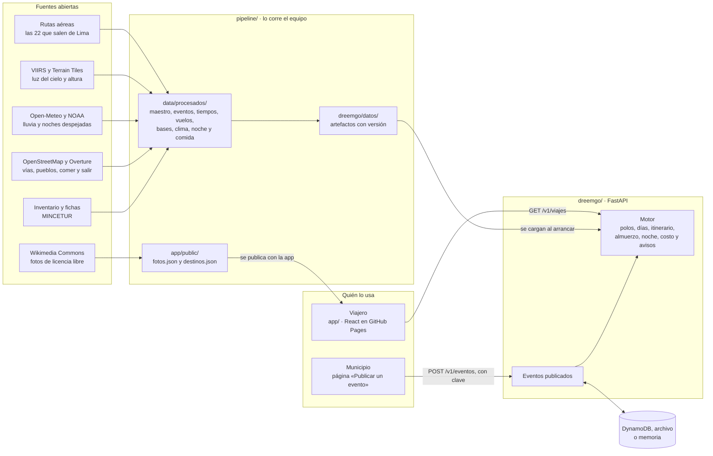

# Informe del prototipo · Semana 10

**DreemGO — Inteligencia de rutas en Perú**
DS3022 · Desarrollo de Producto de Datos · UTEC · Prof. Carlos Abel Dominguez Bautista
Entrega: 21 de octubre de 2026 · Estado del prototipo al 20 de octubre: contrato 1.7 y datos `2026.10.8`

## 1 · Qué se puede demostrar hoy

El flujo principal del producto funciona de punta a punta, con datos reales:

1. **El viajero pregunta.** Dice desde cuál de 24 ciudades sale, cuántos días tiene, en qué mes o desde qué fecha viaja y, si quiere, qué le interesa, cuánto piensa gastar, hasta qué altura tolera, si prefiere ir solo por tierra y a qué zona quiere ir.
2. **DreemGO propone tres viajes**, cada uno a un polo turístico distinto, para comparar: su costo en una banda, cómo se llega (en bus, en bus de noche, en avión, en tren o en bote) y en cuántas horas, si el mes conviene y por qué ese polo. Si el viajero eligió una zona, arma solo ese viaje; si no cabe, dice qué lo impide y con qué cambio sale.
3. **Cada viaje trae su itinerario día por día:** qué visitar, en qué orden y a qué hora se llega, dónde almorzar, qué hacer de noche y, en la altura, un primer día tranquilo; sobre un mapa, con el enlace de cada parada a su ficha oficial de MINCETUR y las fiestas que caen en esas fechas.
4. **El viaje se comparte con un enlace.** No hay cuentas: la misma consulta con los mismos datos da siempre la misma respuesta.
5. **Un municipio publica un evento** con su lugar marcado en un mapa, y el evento sale en el calendario y en las rutas que pasan cerca en esas fechas, con el nombre de quien lo publicó.

La app está publicada en <https://oswaldoaqm.github.io/Alejandros-Team/> y le pregunta al API desplegado en Render, <https://alejandros-team.onrender.com>. El mismo flujo corre en una computadora con los pasos del [`README.md`](./README.md).

Desde el 10 de octubre se sumaron cinco cosas, cada una con su decisión: los vuelos ([0016](../../docs/decisiones/0016-vuelos.md)), «Quiero ir a…» ([0017](../../docs/decisiones/0017-quiero-ir-a.md)), la noche ([0018](../../docs/decisiones/0018-planes-de-noche.md)), un plan creíble, con el almuerzo y el bus de noche ([0019](../../docs/decisiones/0019-plan-creible.md)), y el primer día tranquilo en la altura ([0020](../../docs/decisiones/0020-primer-dia-tranquilo.md)). La evaluación de la semana 12 ya tiene su kit ([0021](../../docs/decisiones/0021-evaluacion-semana-12.md)).

## 2 · Funciones implementadas

### El motor y su API

| Función | Dónde | Qué hace |
|---|---|---|
| Proponer viajes | `GET /v1/viajes` | Hasta tres rutas de polos y bases distintas, o la de una zona elegida, con días, paradas, almuerzo, noche, traslado, costo, clima del mes, eventos, avisos y motivos. Si no sale ninguna, por qué y qué cambiar |
| Opciones del formulario | `GET /v1/opciones` | Orígenes, intereses con cuántas paradas atiende cada uno y cuáles son de noche, y rangos: la app no los fija |
| Ficha de un polo | `GET /v1/polos/{id}` | Sus paradas por jerarquía, su clima de los doce meses, sus eventos del año y su noche: dónde salir, cuánta luz tiene su cielo y cuántas noches salen despejadas |
| Calendario | `GET /v1/eventos` | Fiestas y eventos entre dos fechas, de un polo o de todo el país, cada uno con su zona |
| Publicar un evento | `POST /v1/eventos` | Con clave de publicador. Lo publicado se suma a las rutas cercanas sin cambiar cuáles se proponen |
| Estado | `GET /v1/salud` | Versión del servicio, del contrato y de los datos |

Lo que recibe y devuelve cada uno está en el [contrato](../../docs/CONTRATO.md), versión 1.7, y el esquema OpenAPI sale del código. De la 1.2, la de la primera versión de este informe, a la 1.7, cada versión sumó campos sin quitar ninguno. Los errores llegan en español y con el campo al que se refieren.

### La app

| Pantalla | Qué permite |
|---|---|
| Formulario | Armar la consulta con las opciones que da el API, elegir una zona («A dónde»), ir solo por tierra o pedir una sorpresa |
| Los tres viajes | Comparar tres tarjetas, cada una con su foto, su precio, cómo se llega y en cuántas horas, y el clima del mes, y abrir cualquiera |
| Un viaje | Por qué conviene y qué saber antes de ir; el plan día por día, entero o un día a la vez, con la hora de cada lugar, el almuerzo, la noche y el día tranquilo; un mapa con un pétalo por día y sus lugares numerados; la banda de costo con su desglose; el veredicto del mes con los mejores meses, y las fiestas. Cada lugar abre una hoja con su foto, sus datos y su ficha oficial. Se guarda, se comparte y se imprime. Si el viaje a la zona elegida no cabe, qué cambiar para que salga |
| La zona de un viaje | Sus lugares, su clima mes a mes, sus fiestas y su noche; y armar un viaje a ella |
| Fiestas | Fiestas y eventos de un mes, por región, y armar el viaje a la zona de una fiesta |
| Guardados | Los viajes guardados en el navegador |
| Publicar un evento | El formulario para municipios, con un mapa para marcar el lugar |
| Cómo funciona | De dónde salen los datos y cómo decide el motor |

Está pensada primero para celular, con tema claro y oscuro. Al abrir baja unos 122 kB; el mapa llega aparte, cuando se abre un viaje, y la lista de zonas, cuando se busca una. Las fotos son de Wikimedia Commons y cada una lleva su autor y su licencia. En la app, un polo se llama zona, y una ruta, viaje.

### Los datos

| Función | Dónde |
|---|---|
| Lectura de las 6 225 fichas oficiales, con la fuente de cada campo | [`pipeline/fichas.py`](../../pipeline/fichas.py), [`maestro.py`](../../pipeline/maestro.py) |
| Calendario de 758 acontecimientos, con la regla de su fecha | [`pipeline/eventos.py`](../../pipeline/eventos.py) |
| Tiempos de viaje por carretera, tren y bote, sobre OpenStreetMap | [`pipeline/red_vial.py`](../../pipeline/red_vial.py), [`tiempos.py`](../../pipeline/tiempos.py) |
| La ida en avión de cada origen a cada base, por las 22 rutas que salen de Lima | [`pipeline/vuelos.py`](../../pipeline/vuelos.py) |
| Dónde se duerme en cada polo, con un polo por cada pueblo donde se duerme, y la altura de cada base según el modelo de elevación | [`pipeline/bases.py`](../../pipeline/bases.py), [`elevacion.py`](../../pipeline/elevacion.py) |
| Clima de cada polo mes a mes, a la altura de su base, y su veredicto | [`pipeline/clima.py`](../../pipeline/clima.py) |
| La noche: dónde salir cerca de cada base, la luz de su cielo, sus noches despejadas y su observatorio | [`pipeline/noche.py`](../../pipeline/noche.py), [`cielo.py`](../../pipeline/cielo.py) |
| Dónde comer cerca de cada lugar y de cada base | [`pipeline/comida.py`](../../pipeline/comida.py) |
| Una foto de licencia libre para los lugares y los pueblos donde se duerme, cuando la hay | [`pipeline/fotos.py`](../../pipeline/fotos.py) |
| Las zonas que busca la app | [`pipeline/destinos.py`](../../pipeline/destinos.py) |
| Artefactos versionados que carga el motor | [`pipeline/artefactos.py`](../../pipeline/artefactos.py) |

Las descargas de cada fuente están en [`pipeline/adquisicion/`](../../pipeline/adquisicion/).

## 3 · Arquitectura

| Pieza | Tecnología | Dónde corre |
|---|---|---|
| Pipeline | Python, pandas, scipy, osmium y pyarrow | En la computadora de un integrante, cuando cambia una fuente |
| Motor y API | Python, numpy, pydantic, FastAPI | Una imagen de contenedor: en AWS Lambda detrás de una HTTP API, en Render o en local |
| Eventos publicados | DynamoDB en AWS; un archivo o la memoria fuera de AWS | Junto al API |
| App | React, Vite, TypeScript, MapLibre GL | GitHub Pages |
| Integración continua | GitHub Actions | En cada pull request: lint, pruebas, imágenes y la app contra el API |

Tres decisiones explican la forma del sistema:

- **El motor responde desde memoria.** Los datos del motor no cambian cuando alguien usa la app, sino cuando el equipo recalcula el modelo. Por eso son archivos con versión que el motor carga al arrancar, y no una base de datos ([decisión 0003](../../docs/decisiones/0003-artefactos-precalculados.md)). Pesan 2,0 MB: los vuelos, la noche, la comida y la altura sumaron 0,3 MB.
- **No hay cuentas.** La consulta viaja en la URL y el motor es determinista, así que el enlace es el viaje guardado ([decisión 0001](../../docs/decisiones/0001-sin-login-y-enlace-compartible.md)).
- **Una sola imagen.** El mismo contenedor corre en Lambda, en un host gratuito y en una laptop ([decisión 0002](../../docs/decisiones/0002-stack-y-despliegue.md)).

Cómo cambió cada pieza frente al diseño de la Delivery 1, y por qué, está en el [contrato §5](../../docs/CONTRATO.md).

## 4 · Datos y artefactos

| Qué | Cuánto | Dónde |
|---|---|---|
| Recursos del inventario, con su ficha leída | 6 225 | [`data/procesados/maestro_v3.csv`](../../data/procesados/) |
| Recursos dentro de un polo | 6 047, en 194 polos | [`dreemgo/datos/recursos.json.gz`](../../dreemgo/datos/) |
| Recursos que pueden ser parada de un itinerario | 4 465 | El resto son fiestas, expresiones de folclore y cumbres |
| Polos | 194, uno por cada pueblo donde se duerme. Salen de los 222 grupos del agrupamiento: los 50 que compartían pueblo se juntaron en 22 | [`data/procesados/polos_bases.csv`](../../data/procesados/) |
| La altura de cada base | Las 194, según Terrain Tiles: 13 no la tenían y otras 11 la tenían estimada por los lugares cercanos | [`data/procesados/altitud_bases.csv`](../../data/procesados/) |
| Ciudades de origen | 24 | [`pipeline/referencia/origenes.csv`](../../pipeline/referencia/origenes.csv) |
| Rutas aéreas | Las 22 regulares que salen de Lima, con su duración publicada y, en 16, su tarifa más baja publicada | [`data/procesados/vuelos_rutas.csv`](../../data/procesados/) |
| Acontecimientos con fecha | 739 de 758: 518 con el día que publica la ficha y 221 calculados | [`data/procesados/eventos_v3.csv`](../../data/procesados/) |
| Polos con su propio clima diario | Los 194: un punto por cada uno de los 222 grupos, y el polo que junta varios toma el de su grupo con más paradas. Las temperaturas se llevan a la altura de la base | [`data/procesados/clima_polo_mes.csv`](../../data/procesados/) |
| Lugares para salir de noche | 1 264 a 1,5 km o menos de una base (443 de OpenStreetMap y 821 de Overture), en 92 polos; 50 tienen cinco o más | [`data/procesados/noche_lugares.csv`](../../data/procesados/) |
| El cielo de cada base | Muy oscuro en 48, oscuro en 89 y con luz en 57; 12 tienen un observatorio o planetario a menos de 45 minutos. Las noches despejadas salen de GOES-16 en 151 polos y de un aeropuerto en 32; en 11 no hay dato | [`data/procesados/cielo_polos.csv`](../../data/procesados/) |
| Dónde comer | Hay algo registrado a 1,5 km o menos de 2 954 de los 6 225 lugares (47 %) y de 154 de las 194 bases | [`data/procesados/comida_cerca.csv`](../../data/procesados/) |
| Paradas con foto | 494 de 4 465, y 92 de los 161 imperdibles. En 128 de los 194 polos hay al menos una | [`app/public/fotos.json`](../../app/public/) |

La versión de los datos es `2026.10.8`. Cada tabla de `data/procesados/` tiene su diccionario, y el manifiesto de los artefactos guarda la fecha de cada fuente y la huella de cada archivo. Todas las fuentes son abiertas y su licencia permite redistribuirlas, salvo los METAR de NOAA: de ellos el repositorio guarda solo la parte de noches despejadas de cada mes, calculada aquí ([`DATA_LICENSES.md`](../../DATA_LICENSES.md)).

## 5 · El componente analítico

El motor no usa modelos supervisados: no hay clics ni valoraciones de los que aprender ([decisión 0004](../../docs/decisiones/0004-sin-modelos-supervisados.md)). Combina cuatro métodos, y cada uno tiene una medida de qué tan bien funciona.

| Método | Qué hace | Qué se midió |
|---|---|---|
| **Agrupamiento** (TA-01) | Junta los recursos en 222 grupos por enlace completo sobre una distancia de viaje, con el diámetro acotado. Los grupos que duermen en el mismo pueblo son después un solo polo: quedan 194 | Ningún grupo pasa de 80 km de viaje efectivo. La alternativa, HDBSCAN, daba grupos de hasta 21 horas de punta a punta |
| **Tiempos de viaje** | Camino más rápido sobre una red de 1,45 millones de vértices, con el tren a Machu Picchu y los botes; en avión, por las 22 rutas que salen de Lima, con el camino a cada aeropuerto | Calibrada con 1 780 recorridos de las fichas: 22 % de error medio y 17 % de mediano, por validación cruzada. La fórmula anterior erraba en 48 % |
| **Estacionalidad** (TA-05) | Una regla de dos ejes sobre diez años de lluvia: el mes se desaconseja, lleva advertencia o conviene | Regla declarada, no predicción. Las horas de sol no se publican: el reanálisis no ve la neblina de la costa |
| **Itinerario** (TA-04) | Elige qué visitar y en qué orden para sumar el mayor valor en jornadas de 8 horas, más una de almuerzo: inserción voraz, 2-opt y tres arranques | Catorce propiedades verificadas sobre 1 000 consultas al azar (sección 7). La brecha contra el óptimo exacto se mide en la semana 12 |

Encima va el **puntaje** que ordena los polos: 70 % la calidad del itinerario, corregida por la temporada, el presupuesto, el bus de noche y, con «Vida nocturna», la noche, y 30 % la novedad, que premia a los polos fuera del circuito de Lima y Cusco y a los más lejanos. La calidad es el valor de lo que se visita: una parada vale 1, 2, 6 o 24 según su jerarquía, para que un lugar imperdible pese más que un día lleno de lugares corrientes. Y no se propone un viaje que pasaría más días en el camino que de visita. El **costo** es una banda y no un precio: va del percentil 20 al 80 de 4 000 simulaciones sobre el rango de cada precio, con su desglose en transporte, vuelos, alojamiento, comida y entradas. El ancho de la banda dice cuánto no se sabe.

Sobre el itinerario van reglas declaradas, cada una con su decisión y su propiedad (sección 7):

- **Se vuela solo a lo lejano:** si por tierra la ida pasa de 16 horas, si en avión se llega al menos media jornada antes y si ida y vuelta en avión no se llevan el 40 % del viaje ([0016](../../docs/decisiones/0016-vuelos.md)).
- **El bus de noche** lleva lo que por tierra toma de 7 a 16 horas, y sus noches van fuera de los días; **cada día con visitas trae una hora de almuerzo**, en un lugar con dónde comer si lo hay a la hora; y la jornada no se corre ni se espera más de una hora en la puerta de un lugar ([0019](../../docs/decisiones/0019-plan-creible.md)).
- **Cada noche que se duerme en la zona puede traer un plan:** salir, con «Vida nocturna»; ver estrellas, con «Naturaleza» o sin intereses; o descansar, la primera noche en la altura ([0018](../../docs/decisiones/0018-planes-de-noche.md)).
- **El primer día en la altura es tranquilo:** si se duerme a 2 500 m o más y se llega desde 1 000 m o más abajo, medio día de visitas, sin subir más de 500 m sobre la base ni caminatas largas, como recomienda el Yellow Book del CDC ([0020](../../docs/decisiones/0020-primer-dia-tranquilo.md)).
- **Con destino**, el motor arma solo el viaje a la zona elegida, con las mismas reglas; si no cabe, dice qué lo impide y cada cambio que propone ya está probado ([0017](../../docs/decisiones/0017-quiero-ir-a.md)).

Las fechas de los acontecimientos se midieron contra 40 anotados a mano: 38 de 39 caen en días de fiesta ([`pipeline/README.md`](../../pipeline/README.md)). Y las noches despejadas de GOES-16, contra los METAR de 13 aeropuertos: fuera de la costa siguen al aeropuerto, con una correlación de 0,53 a 0,98; en la costa no, porque el satélite no ve la neblina (en Lima, −0,81), y ahí mandan los METAR.

## 6 · Lo que el motor propone hoy

Para saber qué recomienda el prototipo, se recorrió una rejilla de 1 152 consultas: las 24 ciudades de origen, viajes de 2, 4, 6 y 9 días y los doce meses, sin intereses ni presupuesto ([`code/cobertura.py`](./code/cobertura.py)). La primera medición, con los datos `2026.10.2`, mostró que el motor no proponía nunca Machu Picchu ni Huaraz. Se midió por qué y, del 7 al 8 de octubre, se cambiaron cuatro cosas: un polo por cada pueblo donde se duerme, una parada imperdible vale más, un día de solo viaje puede durar 9 horas, y ningún viaje pasa más días en el camino que allá ([decisiones 0013, 0014 y 0015](../../docs/decisiones/README.md)). El 10 de octubre entró el clima propio de cada polo (`2026.10.4`), y del 15 al 20, los vuelos, el bus de noche, el almuerzo y el primer día tranquilo (`2026.10.8`).

| Medida | 2 de octubre (`2026.10.2`) | 10 de octubre (`2026.10.4`) | 20 de octubre (`2026.10.8`) |
|---|---|---|---|
| Consultas con tres rutas | 1 104 de 1 152 | 1 092 | 1 140. Las otras 12 dan dos |
| Rutas que vuelan | — | — | 37 %, desde las 24 ciudades |
| Rutas en bus de noche | — | — | 35 % |
| Rutas con un primer día tranquilo en la altura | — | — | 21 % |
| Rutas con el aviso de que la ida y la vuelta se llevan buena parte del viaje | 27 % | 37 % | 7 % |
| Rutas en un mes desaconsejado, siempre con su aviso | — | 140 de 3 396 | 45 de 3 444 |
| Rutas que duermen en Machupicchu Pueblo | 0 | 9, todas desde el Cusco | 1, desde el Cusco |
| Rutas que duermen en Huaraz | 0 | 72, desde siete ciudades | 56, desde ocho, Lima entre ellas |
| Rutas que duermen en la ciudad del Cusco | — | — | 469, desde 23 ciudades |
| Rutas fuera del circuito de Lima y Cusco | 84 % | 77 % | 66 % |
| Polos que aparecen al menos una vez | 83 de 222 | 63 de 194 | 57 de 194 |
| Polos distintos que ve un mismo origen | 11 de mediana, entre 4 y 18 | 10 de mediana, entre 2 y 15 | 13 de mediana, entre 9 y 17 |
| Rutas que se llevan los diez polos más propuestos | 50 % | 57 % | 80 % |
| Tiempo de respuesta, en la misma computadora de dos núcleos | 0,26 s de mediana y 1,0 s como máximo | 0,25 s de mediana y 1,0 s como máximo | 0,40 s de mediana y 1,2 s como máximo |

Lo que ganó el plan está arriba en la tabla: con el bus de noche y los vuelos, el aviso de que el camino se lleva buena parte del viaje bajó de 37 % a 7 %, y Huaraz sale desde más ciudades. De cada 100 días con visitas, 86 traen su almuerzo; los demás terminan sus visitas antes de las 12:30, como el día en que se vuelve en la mañana. En 12 de cada 100 almuerzos no hay dónde comer registrado cerca, y la app dice que lo lleves.

Lo que costó está abajo, y es grande: **el motor reparte menos**. Con vuelos y bus de noche, las ciudades grandes quedan a mano de casi todas las demás: Miraflores, en Lima, sale en el 18 % de las rutas, desde 23 ciudades; Trujillo, en el 16 %; el Cusco, en el 14 %, y los diez polos más propuestos se llevan el 80 %. Machu Picchu sale una sola vez: desde Lima se vuela al Cusco, y la ciudad tiene más que visitar que Machupicchu Pueblo. Con «Historia» sale desde el Cusco ([decisión 0020](../../docs/decisiones/0020-primer-dia-tranquilo.md)), y con «Quiero ir a…», desde cualquier ciudad: desde Lima, en avión y en tren, cabe en cuatro días. Si este balance es bueno no lo dice la rejilla, que no lleva intereses; lo dice la evaluación de la semana 12, con consultas calificadas por el equipo y una variante del motor con más peso para lo pedido.

### El costo como escenario: P50 y P80

En su revisión del 20 de octubre, el profesor armó una copia de trabajo de lo que estaba en `main` hasta entonces, con los datos `2026.10.4`, en la que el presupuesto se compara con el P50 o con el P80 y deja fuera lo que no cabe. Con Lima, julio, cuatro días y S/ 800, la lista cambia según el criterio:

| Criterio | Destinos | Costo según el criterio |
|---|---|---|
| P50, costo central | Huaraz, Huacho y Nasca | S/ 706, S/ 773 y S/ 793 |
| P80, escenario conservador | Trujillo, Huánuco y Pozuzo | S/ 768, S/ 758 y S/ 730 |

El P80 suma unos S/ 110 a cada viaje: Huaraz, Huacho y Nasca pasan los S/ 800 (S/ 816, S/ 887 y S/ 905) y entran los siguientes que caben, con menos puntaje (de 0,60 a 0,42, contra 0,75 a 0,70). El costo de Huacho no es definitivo por tres razones: 8 de sus 18 paradas no tienen información de cobro y no suman nada, y desconocido no significa gratis; P50 y P80 salen de rangos sin calibrar con viajes reales, así que son escenarios y no cotizaciones; y ningún horario, tarifa ni apertura está confirmado. En la hoja de verificación de Huacho quedaron marcadas como «Pendiente de confirmar» la Zona Arqueológica Monumental de Peñico y el Museo Municipal de Hualmay, con las columnas de lo confirmado vacías ([`revision_profesor/`](./revision_profesor/)).

La app de hoy hace otra cosa, a propósito: el presupuesto se compara con el P50 y entra a elegir, pero no esconde. Con S/ 800 salen Trujillo, Huaraz y Huánuco, en bus de noche, y los dos que pasan el monto por S/ 3 y S/ 15 salen con su aviso (propiedad 7). Filtrar con P80, como en la copia, cambiaría esa propiedad: queda para decidirlo en la semana 12.

## 7 · Cómo se prueba

- **921 pruebas del motor, el API, el pipeline y la evaluación**, y **234 de la app**, en cada pull request.
- **Catorce propiedades del contrato** sobre consultas generadas al azar: nada pasa la altitud pedida, ni las paradas ni la base; los días suman lo pedido; ninguna jornada con visitas pasa de 8 horas sin contar el almuerzo, ni un día de solo viaje de 9; toda parada enlaza a su ficha; un mes desaconsejado nunca sale sin aviso; el presupuesto ordena, elige y avisa; la misma consulta da la misma respuesta; la noche no cambia el día; el almuerzo va en su lugar; el bus de noche va cuando debe, y en la altura el primer día es tranquilo. Al cerrar cada etapa se corren con 1 000 consultas.
- **42 pruebas de humo en un navegador**, en tamaño de celular y de escritorio, contra el API de verdad: planear un viaje, abrir el mapa, compartir, guardar, volar o ir solo por tierra, pedir una zona que no cabe, ir en bus de noche, cada tipo de noche y publicar un evento. Revisan también que ninguna pantalla se desborde y pasan un analizador de accesibilidad.
- **Las imágenes del API** se construyen y se arrancan en cada pull request.
- **El despliegue se ensayó** contra un simulador de AWS antes de tener cuenta: la configuración, la tabla y el API contra ella.

## 8 · Límites conocidos

**Del motor**

- **El motor reparte menos desde que vuela.** Los diez polos más propuestos se llevan el 80 % de las rutas de la rejilla, y Machu Picchu sale una vez (sección 6).
- **El valor de una parada es un supuesto.** La escala 1, 2, 6, 24 hace que salgan los destinos más conocidos, pero no está calibrada con viajes reales y concentra las propuestas.
- **Un viaje recorre un solo polo.** No combina polos vecinos, como el Valle Sagrado y Machu Picchu.
- **El itinerario es una heurística.** Todavía no se sabe a qué distancia queda del óptimo.
- **Los vuelos son los que salen de Lima:** entre otras dos ciudades se vuela con escala en Lima, y el pasaje es una banda de la tarifa más baja publicada a 2,2 veces esa, no el precio del día.
- **El bus de noche no conoce los horarios de los buses**, solo la hora que deja llegar a eso de las 6:00, y se cobra a la misma tarifa por km que el de día.
- **El almuerzo no sabe si el lugar está abierto**, y una visita larga que empieza antes lo corre hasta que termina.
- **El día tranquilo es uno solo**, aunque el CDC habla de las primeras 48 horas, y la altura del origen es la de la base de su zona, no la de la ciudad.

**De los datos**

- **Clima:** cada polo tiene el suyo, llevado a la altura de su base, pero es un solo punto por grupo: en un valle profundo o en una ladera, la lluvia de verdad puede ser otra. Las horas de sol no se publican, porque el reanálisis no ve la neblina de la costa.
- **Tiempos de viaje:** el error medio es de 22 %. En tramos de menos de 10 km llega a 31 %, que son 4 minutos de mediana.
- **Costos:** los parámetros de alojamiento, comida y transporte vienen de fuentes publicadas, pero no están calibrados con viajes reales. Por eso el costo se da como banda. Una entrada sin tarifa conocida no suma nada al costo.
- **Acontecimientos:** 19 no tienen fecha, y no se leen las fechas lunares ni las relativas a otra fiesta.
- **La noche:** un bar puede haber cerrado y no se sabe qué noches abre; en 11 polos no hay de dónde sacar las noches despejadas, y la app lo dice; y en el altiplano el cielo suele ser más oscuro de lo que dice el modelo de brillo.
- **Datos personales:** el filtro reconoce a una persona por reglas: sus mayúsculas junto a un teléfono, su tratamiento o su cargo. Un nombre sin nada de eso, en un texto sin teléfono, se queda.
- **Lo que queda fuera de la red:** Madre de Dios no tiene rutas de bote en OpenStreetMap, y 178 recursos no pertenecen a ningún polo.

**Del servicio y de la app**

- **El API corre en un host gratuito.** Render lo duerme a los 15 minutos sin uso, la primera consulta después tarda cerca de un minuto, y lo que publican los municipios se pierde cuando se reinicia. En AWS, el destino, lo publicado dura, pero su arranque en frío todavía no se ha medido. En local arranca en un segundo.
- **Publicar eventos** usa una sola clave compartida, sin moderación. Un evento se retira a mano, y su descripción se guarda pero no se muestra.
- **«Guardados»** vive en el navegador: no pasa de un dispositivo a otro.
- **Fotos:** solo una de cada nueve paradas tiene foto, y poco más de la mitad de los imperdibles. Se eligen por cercanía y por nombre, en Wikidata o por las coordenadas de la foto en Commons, y las 711 propuestas se revisaron a ojo, en miniatura: se quitaron 121. Un error de la fuente que no se vea en la miniatura se queda.
- **La app** imprime sin el mapa, y le pide el fondo del mapa y las fotos a servicios externos: sin ellos sigue, con un mapa liso y sin fotos.
- **No se ha probado con usuarios.** La prueba de usabilidad es de la semana 12, y su guion ya está escrito ([`docs/evaluacion/usabilidad.md`](../../docs/evaluacion/usabilidad.md)).

## 9 · Retos técnicos

| Reto | Cómo se resolvió |
|---|---|
| El inventario trae la latitud y la longitud intercambiadas: con sus etiquetas, ningún recurso cae en el Perú | Se corrige al leer y cada coordenada queda marcada con lo que se le hizo |
| La jerarquía del dataset solo coincide con la ficha oficial en el 59,7 % de los recursos | Se bajan y se leen las 6 225 fichas, y cada campo dice de dónde salió |
| Las fichas escriben las distancias y los tiempos a mano («74 km/ 1 hora con 5 min») | Un lector propio entiende el 98,9 % de las celdas; lo dudoso queda marcado y lo ilegible viaja vacío |
| La distancia en línea recta no dice cuánto se tarda: la fórmula inicial erraba en 48 % | Una red propia sobre OpenStreetMap, calibrada con los recorridos que publican las fichas |
| A Machu Picchu se llega en tren, y a las islas, en bote | El tren y los botes entraron a la red: los pares de origen y base sin camino bajaron de 427 a 24 |
| Las fichas publican el teléfono y el nombre de quien atiende cada lugar | Un filtro los reemplaza al leer la ficha y se revisó a mano sobre las 6 225: ninguno llega al repositorio ni a los artefactos |
| El centro de un polo no es un lugar donde dormir | Cada polo duerme en un pueblo real, elegido por lo cerca que deja las paradas y por su hospedaje |
| Huaraz era la base de cuatro grupos del agrupamiento, que competían entre sí, y el motor no proponía ninguno | Los grupos que duermen en el mismo pueblo son un solo polo, con los tiempos entre sus paradas calculados sobre la red: ninguno de los que ya había cambió |
| El clima de la capital regional no es el del polo: Pozuzo, a 748 m, recibía el de Cerro de Pasco, a más de 4 000 | Un punto de clima por grupo del agrupamiento. La cuota gratuita de la fuente da para 36 por día, y los 222 estuvieron el 9 de octubre |
| Volar a todo no es un buen viaje: la primera regla hacía volar 63 de cada 100 rutas de la rejilla, y Huaraz dejaba de salir | Se vuela solo a lo lejano, y el presupuesto entra a elegir las tres rutas, sin esconder ninguna |
| Un viaje de cuatro días a Huaraz pasaba dos en el camino | El bus de noche: lo que toma de 7 a 16 horas viaja de noche, y sus noches van fuera de los días |
| El plan esperaba en la puerta: el último día en Huacho empezaba a las 18:00, cuando abre su primera parada, y llegaba a la playa a las 19:30 | La jornada no se corre, no se espera más de una hora en la puerta de un lugar y cada día con visitas trae una hora de almuerzo |
| El satélite no ve la neblina de la costa: en julio, GOES-16 da despejada la mitad de las noches de Lima, y el aeropuerto, una de cada veinte | En la costa, las noches despejadas salen de los METAR de sus aeropuertos; afuera, de GOES-16 |
| Los METAR de aeropuertos fuera de Estados Unidos no se pueden redistribuir | El repositorio guarda solo la parte de noches despejadas de cada mes, calculada aquí, con su fuente |
| 13 bases no tenían altura, y sin ella no se sabe si el primer día es en la altura | Terrain Tiles, con SRTM a un segundo de arco: las 194 tienen la suya, y el clima se lleva a esa altura |
| Lo que publica un municipio cambia los datos, y la misma consulta tiene que dar la misma respuesta | La versión de los datos lleva la huella de lo publicado, y lo publicado no entra al puntaje |
| En la nube hay varios servidores a la vez, y quien publica tiene que ver su evento | Cada servidor pregunta cada dos segundos si otro publicó algo |
| Desplegar sin presupuesto y sin cuenta | Una sola imagen para Lambda y para un host gratuito, y un ensayo contra un simulador que encontró dos errores en la guía |
| Que abra en un celular con datos móviles | 122 kB al abrir, y el mapa y la lista de zonas aparte |
| Mostrar los lugares sin fotos propias ni presupuesto para comprarlas | Wikidata dice qué foto de Wikimedia Commons corresponde a cada lugar y, donde no, las coordenadas de la foto. Solo entran las de licencia libre, con su autor a la vista, y cada una se revisó a ojo |

## 10 · Lo que falta

**Para la semana 12**

- **La evaluación, con su kit ya listo** ([decisión 0021](../../docs/decisiones/0021-evaluacion-semana-12.md)): el equipo califica 185 viajes de 40 consultas sin saber de qué sistema sale cada uno (el motor, una guía de lo más conocido y una variante con más peso para lo pedido), con su acuerdo medido. Las cifras ya están escritas, antes de calificar ([`evaluacion/informe.py`](../../evaluacion/informe.py)).
- Una prueba de usabilidad con cinco personas, cinco tareas y el SUS, y tres casos de estudio.
- La brecha del itinerario contra el óptimo exacto, y los tiempos por tierra contra los horarios de los buses.
- Decidir si el presupuesto deja fuera lo que no cabe en P80, como en la copia de revisión del profesor: cambia la propiedad 7.
- Viajes de varios polos.
- Desplegar el API en AWS y medir su arranque en frío, y probar la app en un celular con datos móviles.

**Para la entrega final**

- El informe final, el video, la página del proyecto, y el Canvas y los requisitos finales.
