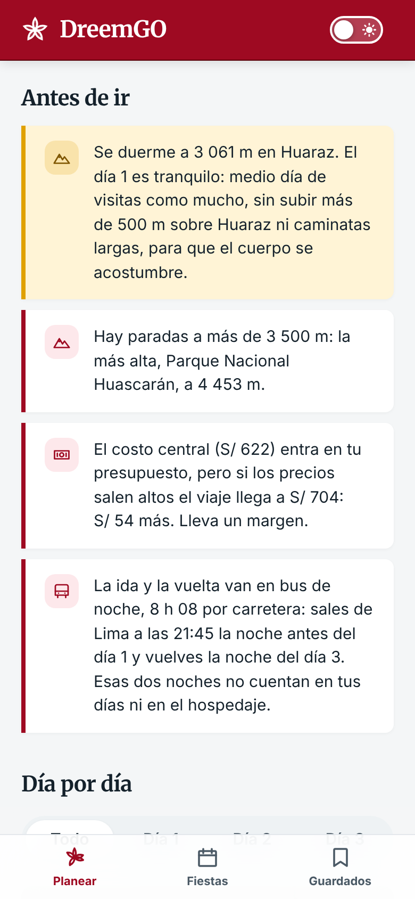
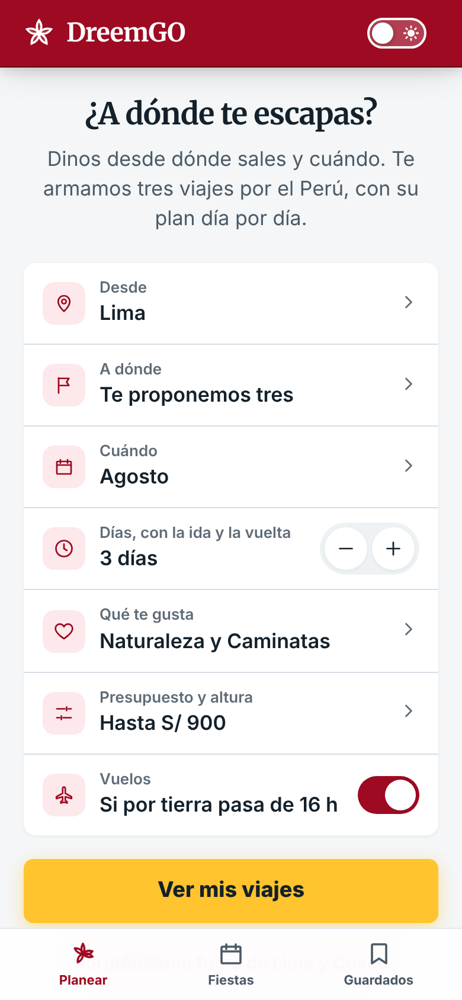
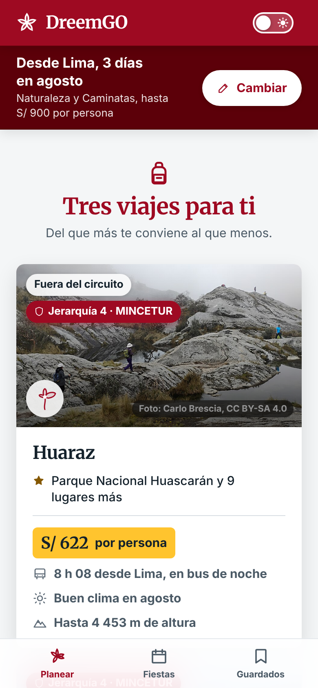
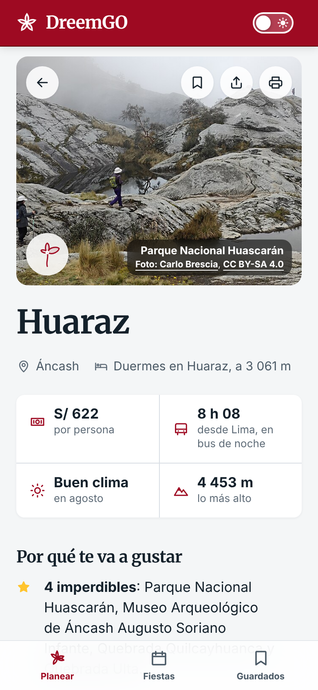
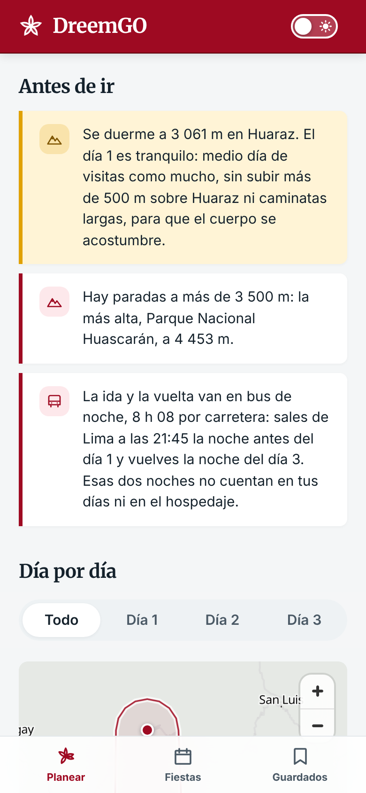
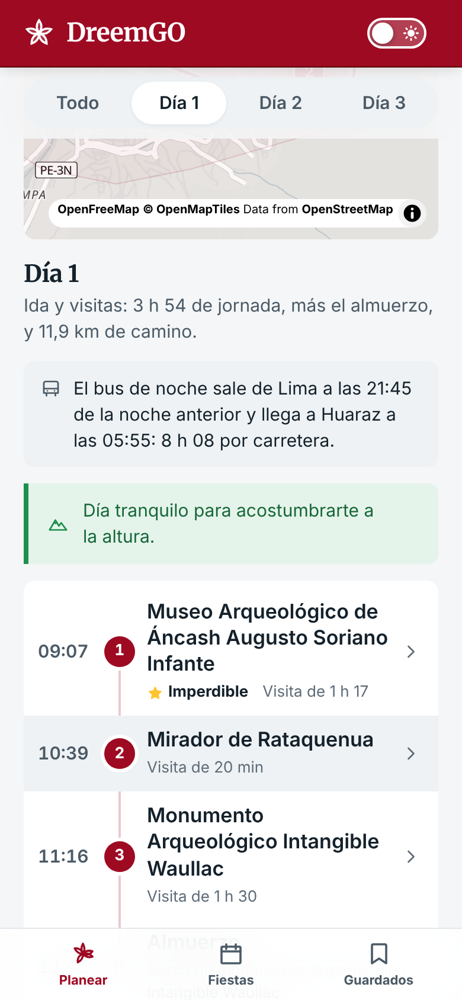
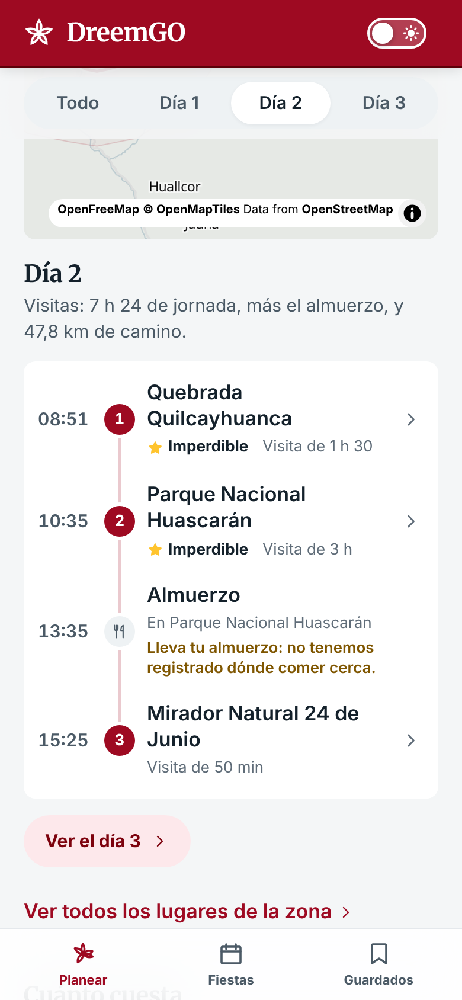
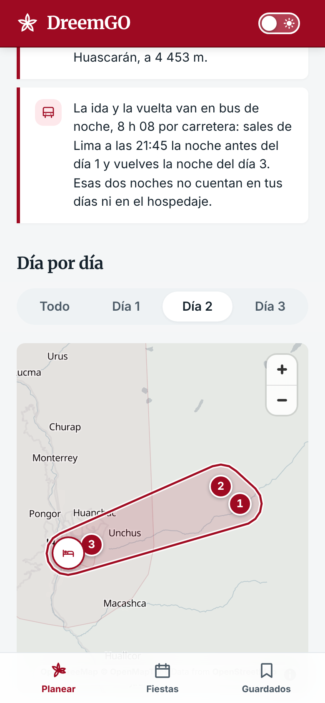
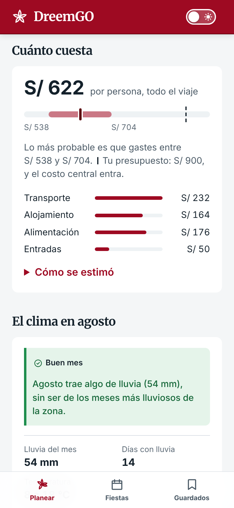
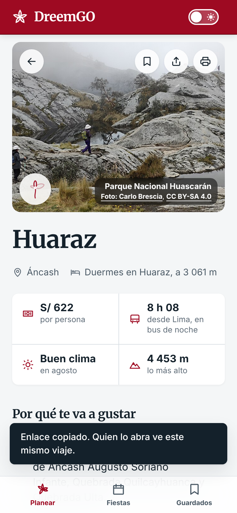

# Informe de evaluación · semana 12

DreemGO · DS3022 Desarrollo de Producto de Datos, UTEC · Entrega del 28 de octubre de 2026 · Contrato 1.7, datos `2026.10.8`

Equipo: Miguel, Alejandro, Diego y Christopher.

El itinerario que arma la heurística junta el 99,1 % del valor que junta el óptimo exacto, en los 120 viajes que propone el motor para las 40 consultas de la evaluación, reducidos a sus 15 mejores lugares. Los kilómetros del camino por tierra quedan a menos de 7 % de los que publica Cruz del Sur, pero en la Carretera Central el motor tarda entre 18 y 26 % menos que el bus más rápido, y eso atrasa la llegada del bus de noche a Oxapampa en más de dos horas. Con las horas de esa misma red, 82 de los 222 grupos de lugares de TA-01 pasan de las cuatro horas de punta a punta que prometía el modelo de la semana 6; una v3 que agrupa con esas horas lo cumple por construcción y deja en un grupo al 93 % de las paradas. Un filtro de presupuesto con el P80, como el de la copia de revisión del profesor, dejaría sin ningún viaje a 18 de las 40 consultas con S/ 800 por persona: por eso el presupuesto avisa y no esconde. Y las catorce garantías del contrato se cumplen en 1 000 consultas al azar.

## 1 · Qué se evalúa

DreemGO le propone a un viajero tres viajes por el Perú, cada uno con su plan día por día. La evaluación responde seis preguntas. Cada una se mide contra algo que no es el motor: una línea de base, el óptimo, una fuente externa o una regla escrita antes de medir.

| Pregunta | Contra qué se mide | Sección |
|---|---|---|
| ¿El motor propone algo distinto de lo que daría una guía de viajes? | Una guía por intereses, la línea de base, y una variante del motor, en 40 consultas escritas a mano | 4.1 |
| ¿El plan de cada viaje junta lo mejor que cabe? | El óptimo exacto del mismo problema | 4.2 |
| ¿Los tiempos del plan son creíbles? | Los tiempos y los kilómetros de una empresa de buses | 4.3 |
| ¿Los lugares de cada grupo quedan a un día de viaje entre sí? | Las horas de la red vial, en la v2 de TA-01 y en una v3 que agrupa con ellas | 4.4 |
| ¿Cada respuesta cumple lo que promete? | Las catorce propiedades del contrato, con 1 000 consultas al azar | 4.5 |
| ¿El presupuesto debe dejar fuera lo que no cabe? | Las mismas consultas con un filtro en el P50 o en el P80 | 4.6 |

## 2 · Las consultas y los sistemas

**Las 40 consultas** ([`evaluacion/consultas.csv`](../../evaluacion/consultas.csv)) son personas con un viaje en mente, escritas para cubrir lo que el producto promete: 15 orígenes, 16 desde Lima; de 2 a 10 días, 34 de ellas de 2 a 5; los doce meses; cada interés al menos dos veces y cinco sin ninguno; 8 con presupuesto, y también altitud máxima, «Solo por tierra», «Sorpréndeme» y dos con fecha, Semana Santa y el Inti Raymi de 2027. Por ejemplo: «Dos amigas de Lima que quieren caminar en la sierra un fin de semana largo de agosto, con S/ 900 cada una».

**Tres sistemas** proponen hasta tres zonas para cada consulta ([decisión 0021](../../docs/decisiones/0021-evaluacion-semana-12.md)):

- el **motor** desplegado;
- la **guía**, que es la línea de base: entre las zonas que caben con las mismas reglas del motor, las tres más conocidas por lo que se pidió, sumando el valor de sus lugares de esos intereses, sin mirar el mes, el presupuesto ni lo poco visitado ([`linea_base.py`](../../evaluacion/linea_base.py));
- la **variante**, el motor con la décima parte en vez de la cuarta para un lugar que no es de lo pedido ([`variante.py`](../../evaluacion/variante.py)). No está desplegada: sirve para ver qué cambiaría ese peso.

El viaje a cada zona es el que arma el motor, para los tres sistemas, así que entre ellos se compara qué zonas se proponen y en qué orden. Las mismas 40 consultas sirven para el óptimo (4.2) y para los filtros de presupuesto (4.6).

## 3 · Las métricas

| Métrica | Qué mide | Por qué esta |
|---|---|---|
| Cobertura y novedad | Cuántas zonas distintas propone cada sistema, qué parte de sus viajes va fuera del circuito de Lima y el Cusco, y la novedad media de lo propuesto | El producto promete sacar al viajero de lo de siempre |
| Coincidencia con la línea de base | En cuántas propuestas coinciden el motor y la guía, consulta por consulta | Si coinciden en todo, el motor no agrega nada a una guía |
| Brecha contra el óptimo | Cuánto valor deja la heurística frente al mejor itinerario con las mismas reglas | El óptimo no cabe en el segundo de respuesta del API, pero sirve de vara |
| Razón contra los buses | El tiempo y los kilómetros del motor sobre los de la empresa, y si el tiempo cae en su rango | Un plan con tiempos irreales no se puede seguir |
| Diámetro en horas | El viaje más largo entre dos lugares de un mismo grupo, de puerta a puerta por la red | Un grupo es un lugar al que se va a dormir: desde ahí, sus lugares tienen que quedar a un día de viaje |
| Garantías del contrato | Si cada respuesta cumple las catorce propiedades de [`CONTRATO.md`](../../docs/CONTRATO.md) §3 | Lo que promete una respuesta tiene que valer para cualquier consulta, no solo para las 40 |
| Consultas sin viaje | Con cada filtro de presupuesto, cuántas consultas se quedan sin nada que mostrar | Es lo que cuesta filtrar |

## 4 · Resultados

### 4.1 · Qué zonas propone cada uno

| | Motor | Guía | Variante |
|---|---|---|---|
| Zonas distintas en las 40 consultas, de 194 | 30 | 35 | 33 |
| Viajes fuera del circuito de Lima y el Cusco | 75 % | 58 % | 74 % |
| Novedad media de lo propuesto | 0,41 | 0,36 | 0,41 |

El motor reparte menos que la guía entre zonas distintas, pero lleva más viajes fuera del circuito. La guía, que elige lo más conocido, se va más al Cusco y a Lima.

El motor no repite a la guía. Coinciden en 60 de sus 120 propuestas, y solo en 2 de las 40 consultas proponen las mismas tres zonas. La variante, en cambio, se parece mucho al motor: cambia una zona en 10 consultas y deja iguales las otras 30. Dónde cambia se ve en el caso 5.2. Las cifras salen de [`evaluacion/zonas.py`](../../evaluacion/zonas.py).

### 4.2 · El itinerario contra el óptimo exacto

El planificador elige qué visitar cada día y en qué orden con una heurística: inserción voraz, 2-opt y tres arranques. El problema exacto, con 40 lugares candidatos y hasta 14 días, no cabe en el segundo de respuesta ([decisión 0009](../../docs/decisiones/0009-viaje-en-estrella.md)). Para medir cuánto se pierde, [`evaluacion/optimo.py`](../../evaluacion/optimo.py) resuelve exacto los 120 viajes que propone el motor para las 40 consultas, con sus jornadas tal cual y solo sus 10, 12 o 15 mejores candidatas, y corre la heurística sobre la misma instancia. Las reglas son las mismas porque las decide la misma función del motor, `horario`: el horario de cada lugar, el almuerzo, una hora de espera como mucho, la jornada que no se corre, el día tranquilo en la altura y seis paradas por día. La búsqueda es exhaustiva, con podas que solo cortan lo que ninguna continuación puede arreglar, y se comprobó contra la fuerza bruta en instancias de juguete.

| Candidatas por viaje | 10 | 12 | 15 |
|---|---|---|---|
| Viajes en que la heurística visita todas | 80 | 70 | 46 |
| Viajes en que hay que elegir | 40 | 50 | 74 |
| En cuántos de esos da el óptimo | 30 | 24 | 27 |
| Brecha media, donde hay que elegir | 1,2 % | 1,5 % | 1,7 % |
| Brecha mediana | 0 % | 0,1 % | 1,1 % |
| Brecha en el 90 % de los casos, como mucho | 3,1 % | 4,0 % | 4,3 % |
| Brecha máxima | 17,0 % | 17,0 % | 17,0 % |
| Valor que junta la heurística, sumando los 120 | 99,7 % | 99,6 % | 99,1 % |
| Segundos de la búsqueda exacta, mediana y máximo | 0,1 y 0,7 | 0,4 y 3,5 | 3,6 y 56 |

Ninguna búsqueda quedó sin resolver. Con 20 candidatas, la de las primeras cuatro consultas no terminó en diez minutos: el tiempo crece tan rápido que el óptimo exacto no puede ir en el API.

**Dónde pierde.** Con 15 candidatas, la heurística no da el óptimo en 47 viajes. En 34 de ellos el óptimo visita una o dos paradas más: la heurística llena el día y no prueba a reordenarlo para que entre una más. En 10 visita la misma cantidad de paradas pero otras de más valor, y en 3, menos paradas que valen más. La pérdida más grande es la de Nauta, desde Iquitos, con 17 %: en uno de sus cuatro días no entra la Comunidad Nativa Amazonas, que el óptimo sí mete. Los viajes de tres y cuatro días son los que más pierden, 2,4 % y 2,3 % de media; los de dos y los de cinco o más, menos de 1 %.

La heurística está cerca del óptimo, pero no lo alcanza: le falta una búsqueda local que pruebe meter una parada más moviendo las otras. Eso entra en el [plan de las tres semanas](./PlanFinal.md).

### 4.3 · Los tiempos por tierra contra los de una empresa de buses

El motor calcula la ida por carretera sobre una red propia de OpenStreetMap, calibrada con 1 780 recorridos de las fichas de MINCETUR, con 22 % de error medio ([decisiones 0007](../../docs/decisiones/0007-red-vial-propia.md) y [0008](../../docs/decisiones/0008-calibrar-con-las-fichas.md)). Esos recorridos son cortos, de un pueblo a sus lugares. Para los largos, [`evaluacion/buses.py`](../../evaluacion/buses.py) compara el motor con las 29 rutas de Cruz del Sur que unen un origen del motor con la base de una zona ([`buses.csv`](../../evaluacion/buses.csv)), con lo que dice la página de cada ruta el 26 de octubre: entre cuánto y cuánto toma el viaje, de su servicio más rápido al más lento, y sus kilómetros.

- **Los kilómetros coinciden.** La mediana de la razón entre los del motor y los de la empresa es 0,985, y ninguna ruta se aleja 7 %: la red sigue la carretera.
- **Los tiempos, en 16 de 29, caen en el rango de la empresa**, y la mediana de la razón contra la mitad de su rango es 1,03.
- **En la Carretera Central, el motor es más rápido que cualquier bus**, y tarda entre 18 y 26 % menos que el más rápido: Lima–La Merced, 6 h 17 contra 8 h 30 a 10 h 05; Lima–Oxapampa, 8 h 02 contra 10 h 30 a 12 h; Lima–Huancayo, 6 h 03 contra 7 h 30 a 8 h 55, y Lima–Jauja. Es la carretera que sube a 4 800 m por Ticlio con tráfico pesado, y la red no lo sabe.
- **En la costa pasa al revés**: de Lima a Paracas y de Ica a Lima el motor tarda más que el bus más lento, 28 % más que la mitad del rango de la empresa. También queda algo por encima del más lento a Chimbote y a Marcona, y en las rutas largas a Lima desde Arequipa, Abancay y el Cusco.

Lo que eso le hace a un viaje: de las 14 rutas que el motor haría en bus de noche, en 4 el bus más lento llega más de una hora después de lo que dice la app, y en 2 ni el más rápido llega a esa hora. La peor es Oxapampa: la app dice que el bus sale a las 21:45 y llega a las 5:50, y con los tiempos de Cruz del Sur llegaría entre las 8:15 y las 9:45, con el primer día ya empezado. Y Lima–Huancayo, que el motor hace de día porque le salen 6 horas, por el bus toma más de 7 y entraría en la regla del bus de noche. Corregirlo cambia el motor y los datos, así que va en el plan de las tres semanas, con las 29 rutas como prueba.

### 4.4 · Los grupos de lugares con las horas de la red

TA-01 agrupa los lugares, y los grupos que duermen en el mismo pueblo forman cada zona del motor ([decisión 0013](../../docs/decisiones/0013-un-polo-por-pueblo.md)). La v2, elegida en la semana 6 ([`ModelSelection.md`](../week06/ModelSelection.md)), usa enlace completo sobre una distancia en línea recta que suma el desnivel, con un diámetro máximo de 80 km efectivos. En la semana 6 eso se leía como 3,9 horas de punta a punta, con una fórmula de 1,6 de sinuosidad y 32,5 km/h que nunca se contrastó: la red vial llegó después, en la semana 7. [`evaluacion/polos_en_horas.py`](../../evaluacion/polos_en_horas.py) mide la v2 con las horas de la red y arma una v3 con ellas.

**La v2, en horas.** Con los minutos de puerta a puerta que usa el motor, el viaje más largo entre dos paradas de un mismo grupo tiene una mediana de 3,4 horas, y 82 de los 222 grupos pasan de cuatro: 48 pasan de cinco y 5 de ocho, como Cajatambo, con 9,8 horas, o Huacrachuco, con 9,1. En 43 grupos hay paradas sin camino por la red entre sí. El motor no se equivoca por eso, porque arma cada día con esos minutos y lo que no cabe en el día no entra, pero un grupo de nueve horas tiene lugares que no se alcanzan a visitar en un día desde su base.

**La v3** es el mismo enlace completo sobre esos minutos, que coinciden con los del motor, a menos de un minuto, en los 208 776 pares de hasta cinco horas que trae su archivo. Tiene cuatro horas de diámetro máximo y, como buscaba la v2, no junta paradas a más de 1 300 m de altura entre sí. Ningún grupo pasa de cuatro horas, por construcción.

| | v2 | v3, 3 horas | v3, 4 horas | v3, 5 horas |
|---|---|---|---|---|
| Grupos | 222 | 235 | 203 | 180 |
| Paradas en un grupo, de 4 578 | 97,5 % | 90,3 % | 93,2 % | 94,3 % |
| Diámetro mediano | 3,4 h | 2,1 h | 2,8 h | 3,3 h |
| Diámetro en el 90 % de los grupos, como mucho | 6,2 h | 2,8 h | 3,8 h | 4,6 h |
| Diámetro máximo | 9,8 h | 2,9 h | 4,0 h | 5,0 h |
| Desnivel máximo | 1 434 m | 1 300 m | 1 300 m | 1 300 m |

Con cuatro horas, la v3 deja sin grupo 246 paradas que la v2 tenía y le da uno a 49 que no lo tenían: quedan fuera las que no tienen cuatro paradas más a cuatro horas. Las dos particiones se parecen, con un índice de Rand ajustado de 0,75 y el 83 % de los pares que la v2 juntaba todavía juntos, pero 127 grupos de la v2 se parten. El tope de altura importa: sin él, la v3 de cuatro horas junta paradas de la costa con otras a más de 4 000 m.

Pasar el producto a la v3 cambia las zonas que propone, sus bases y el clima de cada una, y obliga a rehacer los datos, las pruebas y lo medido en este informe. Por eso esta semana queda medida y no puesta: entra en la semana 14 del plan, con una versión nueva de los datos ([decisión 0023](../../docs/decisiones/0023-ta01-v3-horas-reales.md)). Cuánto mide cada grupo de la v2 y en qué grupo de la v3 queda cada parada está en [`resultados/polos_v2_horas.csv`](./resultados/polos_v2_horas.csv) y [`resultados/polos_v3.csv`](./resultados/polos_v3.csv).

### 4.5 · Las garantías de cada respuesta

El contrato del API promete catorce propiedades de cada respuesta, desde que ninguna parada pase de la altura pedida hasta que el primer día en la altura sea tranquilo ([`CONTRATO.md`](../../docs/CONTRATO.md) §3). [`tests/test_propiedades.py`](../../tests/test_propiedades.py) las revisa sobre consultas generadas al azar con hypothesis, siempre las mismas, contra los artefactos que se entregan. Con 1 000 consultas pasan todas. Las reglas más nuevas se ejercitan: el 31,5 % de esas consultas tiene algún bus de noche, el 18,8 % algún día tranquilo y el 54 % algún almuerzo donde no hay registrado dónde comer. Otra prueba publica eventos al azar sobre 250 consultas y comprueba que se suman sin mover ninguna ruta.

Sobre el código de esta entrega pasan además las 968 pruebas de Python, del motor, el API, el pipeline y la evaluación; las 243 de la app, contra un API de mentira; y las 60 de la prueba de humo, que abre la app compilada en un navegador, en celular y en escritorio, contra el API de verdad, con un analizador de accesibilidad en las nueve pantallas, en claro y en oscuro. Lo que imprime cada una está en [`pruebas/`](./pruebas/), con el script que lo produjo y el árbol del repositorio sobre el que corrió.

### 4.6 · El presupuesto: P50 o P80

Hasta el 27 de octubre el presupuesto se comparaba solo con el P50, el costo central: un viaje que lo pasa compite castigado y sale con su aviso, pero no se esconde (propiedad 7 del [contrato](../../docs/CONTRATO.md)). En su revisión del 20 de octubre, el profesor armó una copia que deja fuera lo que no cabe, con el P50 o con el P80, y el informe de la semana 10 dejó la decisión para esta semana. [`evaluacion/presupuesto.py`](../../evaluacion/presupuesto.py) mide qué cambia con cada filtro, con el mismo motor:

| Consultas | Hoy, viajes que pasan el monto en el P50 | En el P80 | Con filtro P50, consultas sin ningún viaje | Con filtro P80 |
|---|---|---|---|---|
| Las 8 que traen presupuesto | 6 de 24 | 8 de 24 | 2 de 8 | 2 de 8 |
| Las 40, con S/ 500 por persona | 95 de 120 | 105 de 120 | 27 de 40 | 34 de 40 |
| Las 40, con S/ 800 | 51 de 120 | 72 de 120 | 13 de 40 | 18 de 40 |
| Las 40, con S/ 1 200 | 18 de 120 | 34 de 120 | 3 de 40 | 6 de 40 |
| Las 40, con S/ 2 000 | 6 de 120 | 11 de 120 | 0 de 40 | 1 de 40 |

Con S/ 800, que es un fin de semana largo modesto, el filtro P80 cambia las propuestas de 27 consultas y deja a 18 sin nada que mostrar. Y 21 de los 120 viajes entran en el P50 pero pasan en el P80: son los que tienen más riesgo de costar más de lo que la persona dijo. Los costos son una banda sin calibrar con viajes reales, así que el P80 es un escenario y no un precio.

**Lo que se decidió** ([decisión 0022](../../docs/decisiones/0022-presupuesto-con-margen.md)): el presupuesto no deja fuera ningún viaje, y si el costo central entra pero el P80 no, el viaje sale con un aviso. La propiedad 7 lo verifica sobre consultas al azar. Como el aviso no cambia qué zonas se proponen ni en qué orden, todo lo medido en esta sección y en las anteriores vale igual con él.

| | |
|---|---|
|  | Las dos amigas de 5.1, si en vez de S/ 900 pudieran gastar S/ 650 cada una. El viaje a Huaraz sale igual, primero, y en «Antes de ir» dice: «El costo central (S/ 622) entra en tu presupuesto, pero si los precios salen altos el viaje llega a S/ 704: S/ 54 más. Lleva un margen». |

## 5 · Casos de estudio

### 5.1 · Dos amigas que quieren caminar en la sierra

Es la consulta 2: dos amigas de Lima con un fin de semana largo de agosto, que quieren caminar en la sierra y pueden gastar S/ 900 cada una. Las capturas son de la app con el código de esta entrega, en un celular.

| | |
|---|---|
|  |  |

Abren la app y llenan el formulario sin ir a otra pantalla: desde Lima, agosto, tres días contando la ida y la vuelta, «Naturaleza» y «Caminatas», y hasta S/ 900 en «Presupuesto y altura». Dejan prendidos los vuelos, porque no les importa cómo llegar. La app les propone tres viajes, del que más les conviene al que menos:

- **Huaraz**, S/ 622 por persona, en bus de noche de 8 h 08, con buen clima en agosto y hasta 4 453 m de altura;
- **Huacho**, S/ 584, a 2 h 54 por carretera, en la costa;
- **Oxapampa**, S/ 597, también en bus de noche.

| | |
|---|---|
|  |  |

Abren Huaraz. Arriba, los datos que deciden: el costo, el viaje de ida, el clima del mes y la altura máxima. Debajo, por qué les va a gustar: cuatro imperdibles, entre ellos el Parque Nacional Huascarán y las quebradas Quilcayhuanca y Ulta; 8 de sus 10 paradas son de naturaleza o caminatas, y en esas fechas cae la fiesta de San Roque en Mancos. Antes de ir, la app les dice tres cosas: que se duerme a 3 061 m y el día 1 es tranquilo, para que el cuerpo se acostumbre; que hay paradas a más de 3 500 m; y que la ida y la vuelta van en bus de noche, saliendo de Lima a las 21:45 la noche antes del día 1 y volviendo la noche del día 3, noches que no cuentan en sus días ni en el hospedaje.

| | | |
|---|---|---|
|  |  |  |

El plan día por día se puede seguir. El día 1 llegan a Huaraz a las 5:55, y las visitas empiezan a las 9:07 con el Museo Arqueológico de Áncash, el Mirador de Rataquenua y el sitio de Waullac, con almuerzo a las 12:46: medio día, como pide la altura. El día 2 es el de caminar: la Quebrada Quilcayhuanca a las 8:51, el Parque Nacional Huascarán a las 10:35, el almuerzo a las 13:35, con el aviso de llevarlo porque no hay dónde comer registrado cerca, y el Mirador 24 de Junio a las 15:25. El mapa dibuja cada día como un pétalo que sale y vuelve a la base. El día 3 es la Quebrada Ulta antes del bus de vuelta.

| | |
|---|---|
|  |  |

El costo central es S/ 622 por persona, en una banda de S/ 538 a S/ 704: S/ 232 de transporte, S/ 164 de hospedaje por dos noches, S/ 176 de comida y S/ 50 de entradas. Entra en los S/ 900. Agosto es buen mes allá, con 54 mm de lluvia en 14 días. Para mandárselo a su amiga, una aprieta «Compartir»: el enlace es el viaje, y quien lo abre ve el mismo, sin cuenta.

**Lo que este caso deja ver que falta.** El día 3 mete un rocódromo y una piscigranja de la Dirección Regional de Producción, que están en el inventario con jerarquía 2 y que nadie que viaja a caminar elegiría: el motor no distingue un atractivo de un lugar que solo figura en la lista. La visita de 1 h 30 a la Quebrada Quilcayhuanca es la de su ficha, y una caminata por la quebrada toma más. La segunda opción, Huacho, tiene 5 de sus 12 paradas de naturaleza o caminatas: es la más floja de las tres para dos personas que quieren caminar. Y la tercera, Oxapampa, dice que el bus llega a las 5:50, cuando por lo medido en 4.3 llegaría entre las 8:15 y las 9:45.

### 5.2 · Un fin de semana de playa desde Lima

Es la consulta 15: unos amigos de Lima que quieren playa un fin de semana de enero. El motor propone Huacho, Nasca y Nuevo Chimbote; la guía, Huarmey, Huacho y Paracas; la variante, Nuevo Chimbote, Huacho y Paracas.

Nasca no tiene playas. Sale porque las Líneas son de jerarquía 4 y valen 24; aunque no sean de lo pedido, la cuarta parte de 24 es 6, y una playa de jerarquía 2 vale 2. Es el caso que motivó la variante: con la décima parte, las Líneas valen 2,4 y Nasca sale de la lista, y entra Paracas. Es también una de las 10 consultas en que la variante cambia algo (4.1): el peso de lo no pedido decide poco en general, y aquí decide entre una zona sin playas y una con ellas.

### 5.3 · El montañista de Huaraz

Es la consulta 38: un montañista de Huaraz con tres días de junio para caminar. El motor y la variante le proponen Íllimo, a 11 horas de bus hacia la costa norte, Huacho y La Merced; la guía, Jauja, Marcapomacocha e Íllimo. Ninguno va a la Cordillera Blanca, que es lo que tiene al lado.

Pasa por dos reglas que funcionan bien solas. Una zona cuya base queda a menos de 30 minutos del origen es la misma ciudad y no se propone para dormir: así, desde Huaraz no sale Huaraz. Y las zonas vecinas, como Carhuaz, a 45 minutos, o Caraz, a 85, valen poco, porque los lugares grandes de la cordillera están asignados a la zona de Huaraz. El producto no sirve hoy a quien quiere caminar cerca de casa.

## 6 · Límites

- **Son 40 consultas escritas a mano** para cubrir el producto. Sirven para comparar los tres sistemas sobre las mismas consultas, no para decir cómo le va al motor con cualquier consulta.
- **La cobertura y la novedad dicen a dónde lleva cada sistema, no cuál le conviene más** a quien pidió el viaje. Que el motor saque más viajes del circuito es lo que promete el producto, pero no prueba que esos viajes sean mejores.
- **El óptimo exacto es de instancias reducidas**, con 15 lugares como mucho, contra los 40 de una consulta real. Con más candidatas la brecha puede crecer, como crece de 10 a 15.
- **Los tiempos de los buses son de una sola empresa**, la más grande, y de terminal a terminal; las 29 rutas son las que esa empresa cubre.
- **La v3 está medida, no puesta en el producto.** Lo demás de esta entrega, con los casos, usa los grupos de la v2. Y sus horas son las de la red, con su error: 22 % en recorridos cortos, y en la Carretera Central, más rápido que los buses (4.3).
- **Las propiedades prueban lo que dice el contrato**, no que un viaje sea bueno: que nada pase de la altura pedida, que ninguna jornada pase de 8 horas, que cada parada enlace a su ficha oficial. Si un viaje vale la pena lo miden, en parte, 4.1 a 4.4.

## 7 · Qué cambia con esto

- La heurística del itinerario se queda, y suma una búsqueda local que pruebe meter una parada más ([`PlanFinal.md`](./PlanFinal.md), semana 13).
- Los tiempos por tierra se calibran con los de los buses, empezando por la Carretera Central, y las 29 rutas quedan como prueba (semana 13).
- El presupuesto avisa cuando el escenario caro lo pasa, desde el 27 de octubre, y no deja fuera ningún viaje (4.6).
- Los grupos de TA-01 pasan a la v3, con cuatro horas y 1 300 m como topes, en la semana 14 y con una versión nueva de los datos ([decisión 0023](../../docs/decisiones/0023-ta01-v3-horas-reales.md)). Lo medido en este informe se vuelve a correr con ella.
- Los viajes de varios polos, que el informe de la semana 10 puso para esta semana, pasan a la semana 14: cambian el contrato y el motor, y esta semana el motor solo cambió en un aviso, para que lo medido sea lo que se entrega.

## 8 · Cómo se reproduce cada cifra

Desde la raíz del repositorio, con los pasos de instalación de su [`README.md`](../../README.md#reproducir):

```bash
python -m evaluacion.zonas             # 4.1
python -m evaluacion.optimo            # 4.2, unos 10 minutos
python -m evaluacion.buses             # 4.3
python -m evaluacion.polos_en_horas    # 4.4, con la red que arma pipeline.tiempos
DREEMGO_PROPIEDADES=1000 pytest tests/test_propiedades.py   # 4.5
python -m evaluacion.presupuesto       # 4.6, unos 5 minutos
```

Todo escribe en `data/evaluacion/resultados/`, y la copia de esta entrega está en [`resultados/`](./resultados/). Con los mismos datos sale lo mismo, salvo los segundos de la búsqueda exacta. Las pruebas, con lo que imprime cada una, están en [`pruebas/`](./pruebas/).
