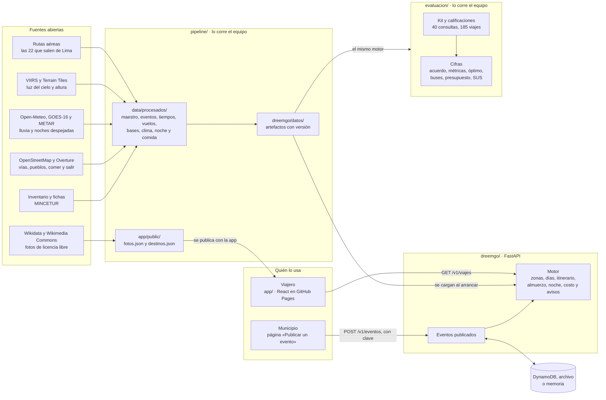
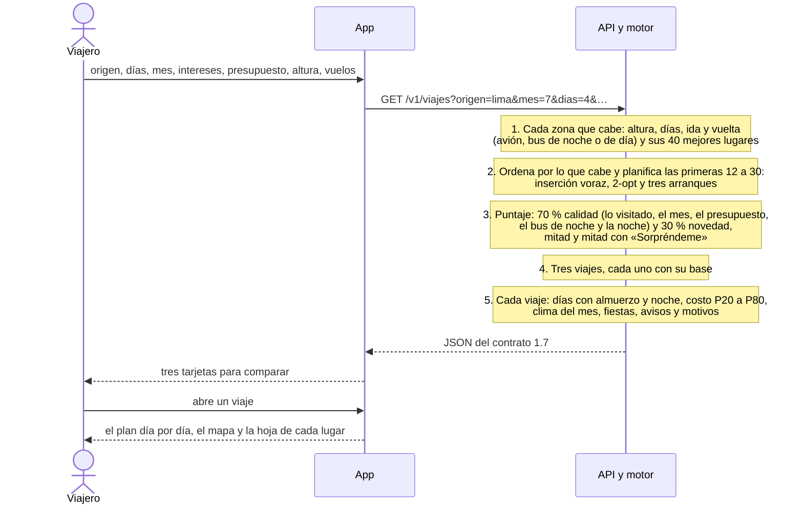
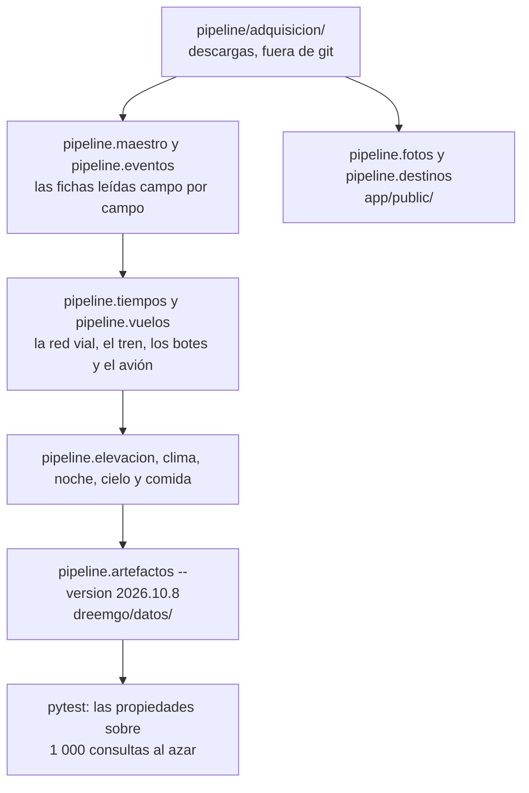
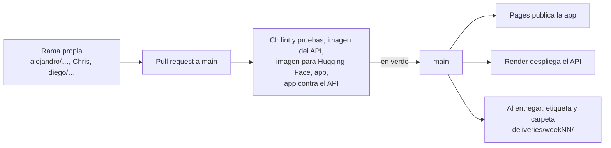

# Arquitectura, flujos e interfaz

Estado al 27 de octubre de 2026, con el [contrato 1.7](./CONTRATO.md) y los datos `2026.10.8`. Este documento junta lo que antes estaba repartido entre el informe de cada semana, el [`README.md`](../README.md) y los README de cada carpeta, y se actualiza cuando cambia una pieza. El porqué de cada cosa está en las [decisiones](./decisiones/).

DreemGO tiene cuatro partes. El pipeline baja fuentes abiertas y las convierte en archivos con versión. El motor carga esos archivos al arrancar y responde desde memoria, detrás de un API. La app web le pregunta al API y muestra los viajes. Y la evaluación mide lo que propone el motor con el mismo código que responde al API.

## Las piezas

| Pieza | Qué hace | Tecnología | Dónde corre |
|---|---|---|---|
| Pipeline ([`pipeline/`](../pipeline/)) | Baja las fuentes, lee las 6 225 fichas oficiales, arma la red vial, el clima, la noche, la comida y las fotos, y escribe los artefactos con versión | Python, pandas, scipy, osmium, pyarrow | En la computadora de un integrante, cuando cambia una fuente |
| Artefactos ([`dreemgo/datos/`](../dreemgo/datos/)) | Lo que el motor necesita, con su manifiesto y la huella de cada archivo: 2,0 MB | JSON comprimido | Dentro de la imagen del API |
| Motor y API ([`dreemgo/`](../dreemgo/)) | Resuelve cada consulta en memoria y recibe los eventos de los municipios | Python, numpy, pydantic, FastAPI | Una imagen de contenedor: en Render hoy, lista para AWS Lambda, o en local |
| Eventos publicados | Lo que publica un municipio, visible para todos los servidores | DynamoDB en AWS; un archivo o la memoria fuera de AWS | Junto al API |
| App ([`app/`](../app/)) | El formulario, los viajes, el plan con su mapa, las zonas, las fiestas y la página para municipios | React, Vite, TypeScript, MapLibre GL | GitHub Pages |
| Evaluación ([`evaluacion/`](../evaluacion/)) | El kit que califica el equipo y las cifras de la semana 12 | Python, scipy, sobre el mismo motor | En la computadora de un integrante |
| Integración continua ([`.github/workflows/`](../.github/workflows/)) | Revisa cada pull request y publica la app al fusionar | GitHub Actions | GitHub |

Tres decisiones explican la forma del sistema:

- **El motor responde desde memoria.** Sus datos cambian cuando el equipo recalcula el modelo, no cuando alguien usa la app. Por eso son archivos con versión que se cargan al arrancar, y no una base de datos ([decisión 0003](./decisiones/0003-artefactos-precalculados.md)). En Render, con una consulta completa, el API llega a 91 MB de memoria.
- **No hay cuentas.** La consulta viaja en la dirección y el motor es determinista: el enlace es el viaje guardado ([decisión 0001](./decisiones/0001-sin-login-y-enlace-compartible.md)).
- **Una sola imagen.** El mismo contenedor corre en Lambda, en un host gratuito y en una laptop ([decisión 0002](./decisiones/0002-stack-y-despliegue.md)).

## Cómo se resuelve una consulta

Los pasos son los de `resolver` en [`dreemgo/motor/viaje.py`](../dreemgo/motor/viaje.py), y el itinerario, los de [`planificador.py`](../dreemgo/motor/planificador.py). Lo que garantiza cada respuesta son las catorce propiedades del [contrato §3](./CONTRATO.md), que las pruebas verifican sobre consultas al azar. Con «A dónde», el paso 1 es una sola zona, y si no cabe, el motor dice qué lo impide y qué cambiar.

Un municipio sigue otro camino: escribe su evento en la página «Publicar un evento», con su clave, y el API lo guarda. Desde ese momento sale en el calendario y en los viajes que pasan cerca en esas fechas, sin cambiar ninguno ([decisión 0011](./decisiones/0011-eventos-publicados.md)).

## Cómo se arman los datos

Cada paso es un comando de [`README.md`](../README.md#reproducir). Un dato que la fuente no trae viaja como `null`, y cada campo derivado dice de dónde sale. Una versión nueva de los datos es un commit propio, y lo que cambia en las respuestas se mide antes de fusionarla.

## Cómo trabaja el equipo

- **Ramas y commits.** Cada uno trabaja en su rama y fusiona a `main` por pull request; nadie sube directo a `main`. Un cambio por commit, con [Conventional Commits](https://www.conventionalcommits.org/es/v1.0.0/) en español.
- **La CI** corre en cada pull request: ruff y pytest; las dos imágenes del API, que arrancan, publican un evento y no lo pierden; la app con Biome, TypeScript, sus pruebas y su construcción; y una prueba de humo en un navegador, en celular y en escritorio, contra el API de verdad y con un analizador de accesibilidad. Un pull request en rojo no se fusiona.
- **Al fusionar**, el flujo `Pages` vuelve a publicar la app si cambió `app/`, y Render despliega el API desde `main`.
- **Contrato primero.** Un cambio en lo que el API recibe o devuelve empieza en [`dreemgo/contrato.py`](../dreemgo/contrato.py) y en [`CONTRATO.md`](./CONTRATO.md), y la app regenera sus tipos con `npm run tipos`.
- **Entregas.** Cada semana tiene su carpeta en [`deliveries/`](../deliveries/), con una copia congelada del código y los datos de ese día. Lo que se corrige después va en su `ERRATA.md` ([decisión 0005](./decisiones/0005-historial-y-erratas.md)).

## La interfaz

### El API

Seis rutas, todas bajo `/v1`. El detalle de cada campo está en el [contrato](./CONTRATO.md) y en [`openapi.json`](./openapi.json), y el API desplegado las muestra en [`/v1/docs`](https://alejandros-team.onrender.com/v1/docs).

| Ruta | Qué devuelve |
|---|---|
| `GET /v1/viajes` | Hasta tres viajes para una consulta, o el de la zona elegida; si no sale ninguno, por qué y qué cambiar |
| `GET /v1/opciones` | Los orígenes, los intereses y los rangos del formulario |
| `GET /v1/polos/{polo_id}` | La ficha de una zona: sus lugares, su clima mes a mes, su noche y sus eventos |
| `GET /v1/eventos` | Los eventos entre dos fechas, de una zona o de todas |
| `POST /v1/eventos` | Publica un evento; pide la clave de publicación |
| `GET /v1/salud` | El estado del servicio y la versión de los datos |

### La app

Una sola página, pensada primero para celular. La consulta va en la dirección, así que cada pantalla se puede compartir.

| Dirección | Pantalla |
|---|---|
| `./` | El inicio, con el carrusel de cinco destinos, y el formulario |
| `./?origen=lima&mes=7&dias=4&…` | Los tres viajes en tarjetas para comparar; con «A dónde», el viaje a esa zona o por qué no cabe |
| `…#/ruta/2` | Un viaje: por qué conviene, qué saber antes de ir, el plan día por día con su mapa, su almuerzo y su noche, el costo, el clima y las fiestas |
| `…#/polo/33` | Una zona: sus lugares, su clima de los doce meses, su noche y sus fiestas |
| `…#/calendario` | Las fiestas de un mes, por región |
| `./#/mis-viajes` | Los viajes guardados en ese navegador |
| `./#/acerca` | Cómo funciona y de dónde salen los datos |
| `./#/publicar` | Para municipalidades: publicar un evento con su lugar en un mapa |

Arranca con el tema claro u oscuro del sistema y guarda el que elija la persona. Cómo está hecha cada pantalla está en [`app/README.md`](../app/README.md).

## Lo que cambió desde la semana 10

- **El frontend nuevo del equipo**, del 25 de octubre: el carrusel del inicio, los estilos de cada pantalla y el botón del tema.
- **Las correcciones del 26 de octubre** (PR 42): la duración de la ida es la misma en la tarjeta y en la nota del día, los avisos críticos tienen su propio rojo, el tema oscuro pasa la revisión de contraste en las nueve pantallas, el tema sigue al del sistema, el carrusel deja ver el formulario en el celular y el adaptador de Lambda vuelve a la galería pública de AWS.
- **El presupuesto avisa cuando el escenario caro lo pasa**, el 27 de octubre: si el costo central entra y el P80 no, el viaje sale igual, con un aviso que dice cuánto pasaría ([decisión 0022](./decisiones/0022-presupuesto-con-margen.md)).
- **La evaluación** suma a su kit la búsqueda del óptimo exacto, la comparación con los tiempos de Cruz del Sur, el efecto de un filtro de presupuesto y el puntaje de la prueba de usabilidad, cada uno con su comando en [`README.md`](../README.md#reproducir).
